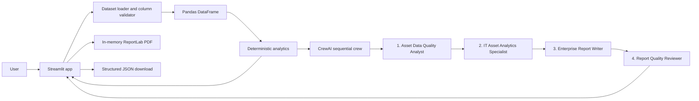
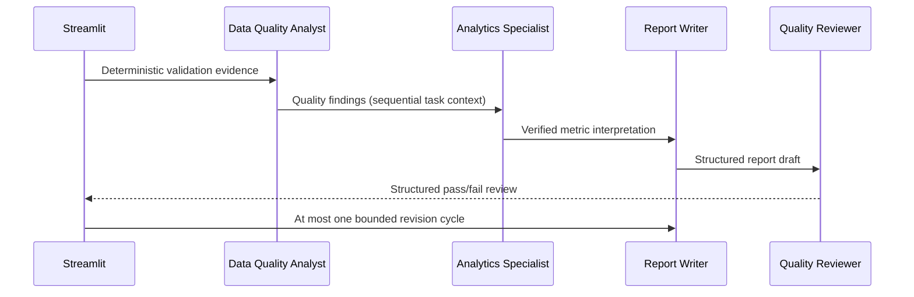

# System architecture

The UI, data processing, analytics, orchestration, and report generation run in one local Python process. The project has no database, worker service, or backend API. Original columns and rows are retained. Analytics produces the numerical source of truth; agents receive summary evidence rather than raw records and must not alter totals.

The `Allocated To` convention uses populated values as allocated. Retirement uses explicit retirement booleans or known status vocabulary; active and unknown are separate. These simple rules make ambiguity visible rather than silently assigning categories. Totals count input rows, including duplicate identifiers; duplicates are flagged, not silently removed.

## Asset Attention Radar

Analytics produces an additional deterministic, explainable per-row review priority. Signals include missing/duplicate IDs, explicit zombie flags, retired-but-assigned records, retirement-field conflicts, warranty dates, and missing selected inventory fields. Weighted points are capped at 100; records scoring 20+ enter the top-25 queue with supporting reasons and a next action. The report date is included because warranty signals are time-relative. Unknown date/boolean values do not become positive signals. The dashboard/PDF show row identifiers for follow-up, but only aggregate radar counts are included in the Gemini evidence prompt.

## Agent workflow

CrewAI tasks use structured Pydantic outputs and sequential dependencies. The application also checks explicitly named metric claims against calculated values. One bounded full-crew revision can occur after a failed review. Provider configuration or execution failures are shown to the user; calculated metrics remain available and no fabricated report is substituted.
